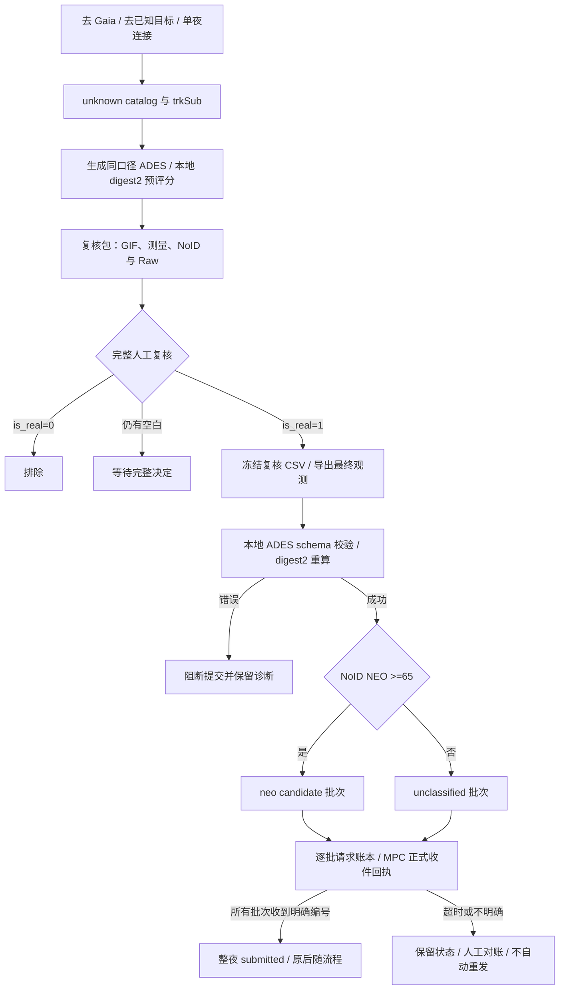

# SMT unknown 流程：digest2 本地评分与 NEW NEO 分流

日期：2026-09-20。已部署至服务器 `/pipeline/xiaoyunao/heliolincrr`，从下一次正常 unknown 流程调用生效。配套 PPT 共 8 页。

这次将 **digest2 NoID NEO ≥65** 接入主流程：全部 unknown 在生成复核包时先评分；人工接受的目标在正式提交前重新评分，按分数拆成 `neo candidate` 和 `unclassified` 两批。**高分不能替代图像真假确认**。

## 1. digest2 解决什么问题

一个单夜 tracklet 通常只有几次天球位置测量。它能约束视运动方向和角速度，但通常不能唯一确定天体的视线距离 ρ 和径向速度 dρ/dt。同样的天球短弧，可能对应不同的日心距离、速度和轨道。

digest2 探索与这些观测相容的一族轨道，再用太阳系小天体种群模型衡量不同轨道类别的相对权重。NEO 的轨道定义是近日点距离 **q <1.3 AU**；65 是 MPC 要求的候选上报阈值，不是轨道分类的物理边界。分数也不是撞击概率、图像检测为真的概率，或某个精密定轨结果的置信度。[Keys 等，2019](https://arxiv.org/abs/1904.09188)

## 2. 本地打分的实际计算过程

本项目使用官方 Python 包 **digest2 2.8.2**，由 Python 调用其 C 计算内核。评分阶段只读取本地文件，不为每个目标请求 MPC 在线服务。

### 2.1 观测输入与运动约束

每个 `trkSub` 的全部测量组成一组输入，按 UTC 时间排序，包含：

| 输入 | 在计算中的作用 |
| --- | --- |
| `obsTime`, `ra`, `dec` | 建立短弧视运动约束 |
| `rmsRA`, `rmsDec` | 描述角位置误差，影响可探索的轨道范围 |
| `stn=327` 与 ObsCodes | 根据台址和观测时间计算观测者位置 |
| `mag`, `band=G` | 估计 V 星等，并约束候选轨道对应的绝对星等 H |

内核根据观测构造代表短弧运动的观测对；多点资料通过其运动拟合/选点逻辑参与约束，并不是独立给每一行打分再平均。随后结合观测者几何、角位置扰动、距离与运动方向搜索候选轨道。[官方算法说明](https://github.com/Smithsonian/mpc-public/blob/main/digest2/digest2/ALGORITHM.md)

具体实现使用 `parse_ades_psv()`，再调用：

```python
with Digest2(model_path=..., config_path=..., obscodes_path=...,
             repeatable=True, no_threshold=False) as engine:
    result = engine.classify_tracklet(observations, classes=["NEO"], is_ades=True)
    neo_noid = float(result.noid.NEO)
    neo_raw = float(result.raw.NEO)
```

官方 PSV parser 会将 G 波段星等以 **V≈G+0.24** 的内部近似用于评分。上报文件仍保留原始 G 星等，不将这个转换写回观测。若手工构造 `Observation(mag=G)` 并跳过 parser，会改变评分口径。[固定版本源码包](https://pypi.org/project/digest2/2.8.2/) 中的 `src/digest2/observation.py` 可核对该转换。

ADES 提供的误差也不是无条件原样使用。2.8.2 的 `d2math.c::updateRMSValues()` 在当前 `no_threshold=False` 下对误差施加配置相关限制：先限制在基准误差的 0.7–5 倍，再施加基准误差下限；对正值输入可概括为限制在基准误差的 **1–5 倍**。基准由台站/默认配置及运动拟合残差的逻辑确定；327 在当前 MPC.config 中没有单独条目，默认配置误差为 1″，但拟合残差可能增大实际基准。因此不能宣称填入 0.1″ 就一定按 0.1″ 探索。配置、算法版本变化可能改变分数。

### 2.2 将候选轨道映射到种群模型

候选轨道和相容星等被映射至 **q、e、i、H** 四维分箱：近日点距离、偏心率、轨道倾角和绝对星等。H 同时取决于视星等、距离和相位几何，不能仅凭图像亮度直接当作已知量。

模型保存各分箱中的预期天体种群及类别种群。搜索在类内、类外分别标记可达分箱；同一类别标记重复命中时，不按采样次数反复累加种群。搜索依据是否继续发现新的分箱标记来细化并终止。这与“随机生成 100 个解，其中 70 个是 NEO，所以得 70 分”的算法不同。[官方算法说明](https://github.com/Smithsonian/mpc-public/blob/main/digest2/digest2/ALGORITHM.md)

固定 2.8.2 源码的 `searchAngles()` 累计类内/类外权重，`score()` 在分母大于零时计算：

```text
Raw NEO  = 100 × W_all,NEO / (W_all,NEO + W_all,nonNEO)
NoID NEO = 100 × W_unk,NEO / (W_unk,NEO + W_unk,nonNEO)
```

这里 W 是被允许的、带有相应类别标记的分箱种群之和，而非抽样轨道条数。公式说明正常非零分母情形；内核对零分母还有特定回退逻辑，因此不能将该分数理解成严格校准的概率。

### 2.3 为什么使用 NoID

- **Raw**：使用总种群模型。
- **NoID**：使用扣除了容易识别的已知天体后的剩余种群模型，适合已做 known-object identification 而仍未识别的轨迹。

这个“扣除”已体现在本地模型中，并不是每次打分都在线查询 MPC、实时删除所有已知小行星。模型更新也不是自动发生的。[官方运行说明](https://github.com/Smithsonian/mpc-public/blob/main/digest2/digest2/OPERATION.md)

历史数据说明两者不能混用：

| trkSub | Raw NEO | NoID NEO | 按 NoID 判定 |
| --- | ---: | ---: | --- |
| 00001nF | 40.65 | 70.97 | 达到 NEW NEO 分流门槛 |
| 00001oj | 16.92 | 73.53 | 达到门槛，但已被人工判假，不能提交 |
| 00001ua | 99.65 | 99.97 | 达到门槛，仍需人工真源决定 |
| 00001vy | 67.78 | 99.28 | 达到门槛，仍需人工真源决定 |

这些是固定历史观测的离线回放分数，不构成新的目标确认或重新上报。

## 3. 更新后的 unknown 主流程



实际调用链保持为 `run_daily_unknown.sh → package_unknown_review.py → watch_submit_reviews.py → submit_reviewed_unknown.py → export_unknown_ades.py`，新增逻辑位于 `digest2_pipeline.py`。不需要修改 cron。

复核包新增 `digest2_scores.csv`（按 NoID 降序）、`digest2_scores.json`、预评分 PSV，以及 manifest 每个目标的 `digest2` 对象。两列 `tracklet_id,is_real` 复核 CSV 保持兼容。**原复核网页本身没有增加分数列**，本次分数展示入口是包内 CSV/JSON；人工继续按既有方式看 GIF、完成 submit CSV。

提交前重新从实际测量构造最终 PSV，冻结人工决定再评分；分流使用未四舍五入的分数，恰好 65 进入候选批。每个目标的全部观测完整进入同一批。原 unified masked JSON/FITS 继续保留，供现有后随程序使用。

## 4. 本次代码改动

| 文件 | 改动 |
| --- | --- |
| `digest2_pipeline.py` | 独立评分子进程、2017 schema 检查、正式 MPC 请求、逐批持久账本 |
| `score_unknown_digest2.py` | 复用已测试的评分/冻结/分流核心；该模块自身没有提交能力 |
| `package_unknown_review.py` | 在复核包生成时给全部 unknown 评分并附带分数 |
| `export_unknown_ades.py` | 完整人工复核门控、冻结复核输入、缺测量阻断、自动拆批；去掉整夜固定 NEO 提交 |
| `submit_reviewed_unknown.py` | 保留原入口；`--validate` 语义改为本地 schema 与评分校验 |
| `watch_submit_reviews.py` | 已 submitted 的夜次保持终态；不因 CSV/manifest 修改再次提交；不明确请求禁止自动重试 |
| `ades_submit.xsd` | 固定官方 ADES 2017 提交 schema，与现有 `# version=2017` 匹配 |
| `tests/test_digest2_pipeline.py` | schema、正式批次状态、部分失败、并发、历史保护测试 |

旧的 `resources/known_asteroid/submit.xsd` 声明的是 2022，不能直接拿它验证本流程的 2017 文件。本次另取官方 2017 schema 原文，来源和 hash 见 `ades_submit.SOURCE.md`。提交头的 fundingSource 简化为短文本，保留团队、台站与望远镜信息。

### 评分与格式失败如何处理

缺测量、重复历元、未知站点、非有限数值、不完整 catalog、parser 丢行、异常分数等不能被当成低分放行。当前实现保守地阻断该次复核包生成或该次正式提交，诊断与输入保留在评分目录。修复数据后重跑；没有自动跳过坏目标并悄悄发送其余目标的行为。

生产 scorer 仅支持当前约定：地面台站、CCD、G 波段、单夜且至少两个不同历元。具有 `permID/provID` 的对象会被拒绝进入这个 unknown NEW NEO 路径。已确认的 MPC designation/NEOCP 后随身份分流仍应走相应专用流程，本次没有新增自动身份查询。

## 5. 部署、依赖与运行产物

生产主程序继续使用原 heliolinc Python。评分子进程使用独立环境：

```text
/pipeline/xiaoyunao/data/heliolincrr/digest2_runtime/env/bin/python
```

其中固定 digest2=2.8.2、numpy=2.2.6、lxml=6.1.3；实际完整环境记录在同目录上一级 `requirements.lock`。原 heliolinc 环境未安装或升级这些依赖。站点表固定为 `digest2_runtime/ObsCodes.html`；模型和配置来自固定包，并在每次评分时复制快照。

每次评分在 `/processed1/YYYYMMDD/L4/digest2/run_*/` 中保存：原 PSV、catalog、原复核 CSV（若有）、标准化接受清单、模型/配置/ObsCodes、`routing.json`、schema 验证证明和分流 PSV。正式账本为：

```text
/processed1/YYYYMMDD/L4/YYYYMMDD_unknown_mpc_batches.json
```

重复运行仍会重算观测，但正式请求根据稳定的 batch ID 去重；batch ID 来自类别和 payload SHA-256。已尝试目标若被改组到新批次，即使 hash 改变也会阻止自动重报。评分工具中的 `offline_rehearsal / production_enabled=false` 表示该评分产物生成阶段不联网；真正的生产请求由单独的 `formal_mpc` 账本管理。

固定依赖的 SHA-256：

| 依赖 | SHA-256 |
| --- | --- |
| model | `2b9d9d2a6d8ab16d3a2dbb835b30d3aa172431f27c3cb7c159675d7686668c45` |
| MPC.config | `5c623453f790db741a924f08a75d451385c15cde4be479660d480cbd2c7d2121` |
| ObsCodes | `c37ef5514a828b7dc5897bc13ef72114a23931bec2f940ca57b460a0ffe5a301` |

测试时可用 `SMT_DIGEST2_PYTHON`、`SMT_DIGEST2_OBSCODES` 覆盖位置，不改变默认服务器路径。

## 6. 回执与重复上报保护

`--validate` 现在是**本地 ADES schema + 完整性 + digest2 分流验证，不发 MPC 请求**。独立测试工具 `validate_neo_batches.py --test-endpoint` 仍保留，但不作为日常正式提交的前置联网步骤。

正式请求固定使用 `https://minorplanetcenter.net/submit_psv`，类别自动选择；通过 `source=<-` 发送已经核对 hash 的字节。连接超时 15 秒、curl 总时限 90 秒，没有隐式网络重试或 POST 跳转。

每批请求前先持久化 `sending`，收到明确 Submission ID 后写 `received`。若请求超时、进程中断或正文不明确，保留 `sending/needs_reconciliation` 并阻止重发。部分成功时保留成功批次，不将整夜标为提交完成。只有所有当前批次都有收件编号，watcher 才继续原有整夜完成与后随处理。

现有 7 个 `submitted` 历史夜次均已验证会被跳过；直接 exporter 也检查历史状态和旧回执。不能通过修改复核文件来触发它们重新上报。部署未改写共享 `review_submit_state.json`。

本次之前的实际测试中，正常样本与 RA=`NOT_A_NUMBER` 样本都曾获得测试 ID。因此 **CurlID 只表示接收请求**，不代表后续字段审核、NEO 确认或 NEOCP 已发布。正式结果仍需结合邮件或 MPC 后续处理核对。[MPC 命令行提交文档](https://docs.minorplanetcenter.net/mpc-ops-docs/observations/command-line-submissions/)

## 7. 验证记录与当前边界

- 本机和服务器各通过 **36 项**针对性测试：包括 64.9/65/65.1 边界、人工否决、缺行、观测 hash、schema、超时、中断、部分成功和双进程去重。
- 先前双平台回放共 125 个目标，Raw/NoID 完全一致；固定模型、配置、站点表与输入后可重复计算。
- 本次使用服务器真实 20260910 数据，在 `/tmp/smt-digest2-production-20260920` 完整回放包生成和导出：**120 目标、372 观测、120 GIF**；107 个目标 NoID≥65。真实人工决定只接受 **4 目标、18 观测**，均进入候选批，另 116 目标被排除。
- 部署后调用生产路径中的实际 exporter，在临时输出目录再次本地验证成功；没有正式 POST，没有重发历史夜次。
- 原复核网页未增加分数列；分数在复核包和 manifest 可见。
- 观测时间沿用当前 exporter。已有审计指出 L2 MJD 起点与曝光中点约 15 秒差异，本次未修正；评分与上报内部一致不代表这个科学时间约定已经正确。修正应统一上游时间定义，再单独回放验证。
- 固定的模型/配置不是在线自动刷新；升级时应先重跑已保存基准。首次新夜的正式邮件回执和 NEOCP 后续结果尚待实际运行产生。

部署备份与记录：`/pipeline/xiaoyunao/data/heliolincrr/digest2_deploy_20260920/`。回退代码时应保留新版提交账本及最新共享状态，不恢复旧状态去覆盖已经发生的请求。

## 8. 后续操作

日常 cron 和人工复核动作保持原入口。优先从复核包的 `digest2_scores.csv` 查看高分对象，然后结合 GIF/测量完成真假决定；提交端会自动使用最终分数分流。

如需仅对一个**未上报的新夜**做本地验证，SSH 登录服务器后执行（将 YYYYMMDD 换成夜次）：

```bash
/home/smtpipeline/Softwares/miniconda3/envs/heliolinc/bin/python \
  /pipeline/xiaoyunao/heliolincrr/submit_reviewed_unknown.py YYYYMMDD --validate
```

该命令生成本地导出、评分和校验产物，不发送 MPC 请求。现有自动 watcher 的 `--submit` 才进入正式上报。

遇到 `needs_reconciliation` 时，查该夜逐批账本的 payload、对象清单、请求时间和回执，结合邮箱/MPC 对账后再决定如何处理。不要删除账本或修改 batch ID 来强行重试。

进一步资料：[digest2 官方仓库](https://github.com/Smithsonian/mpc-public/tree/main/digest2)、[MPC digest2 教程](https://docs.minorplanetcenter.net/tutorials/notebooks/mpc_tutorial_digest2/)、[2023 年算法/模型更新说明](https://arxiv.org/abs/2309.16407)。本项目实际运行口径以固定 2.8.2 源码和快照为准。
