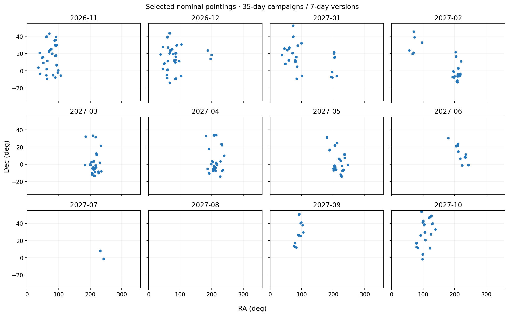
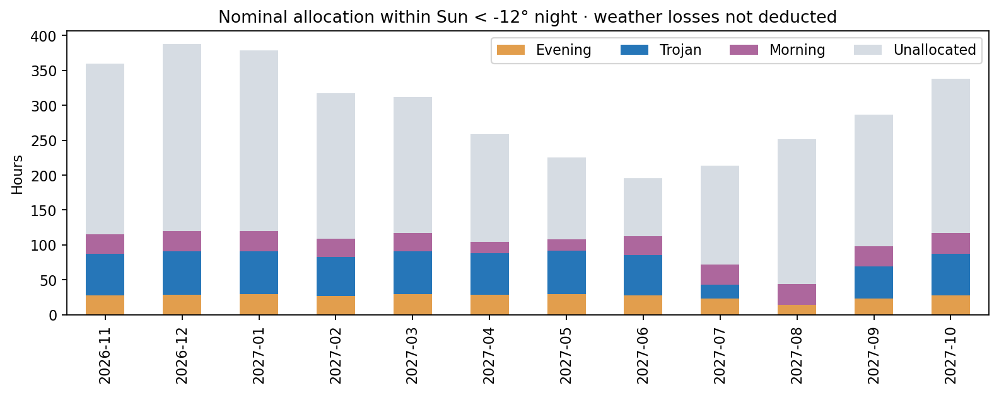
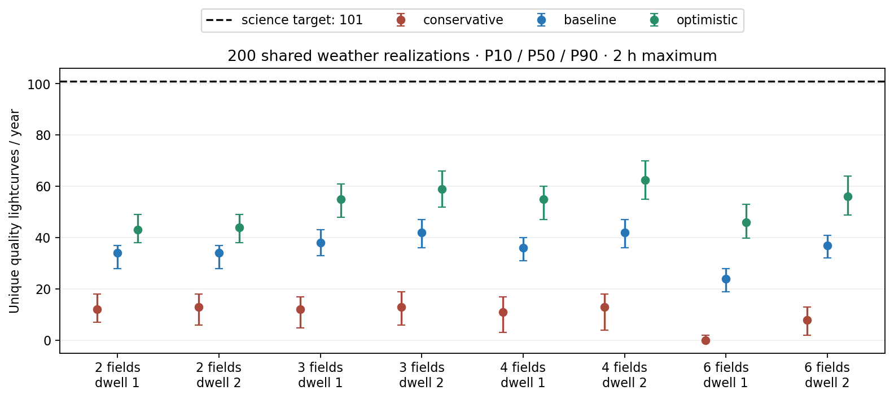
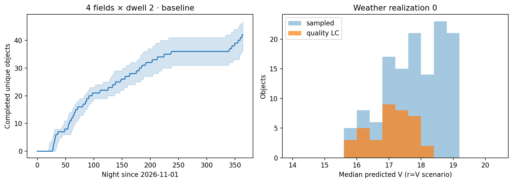
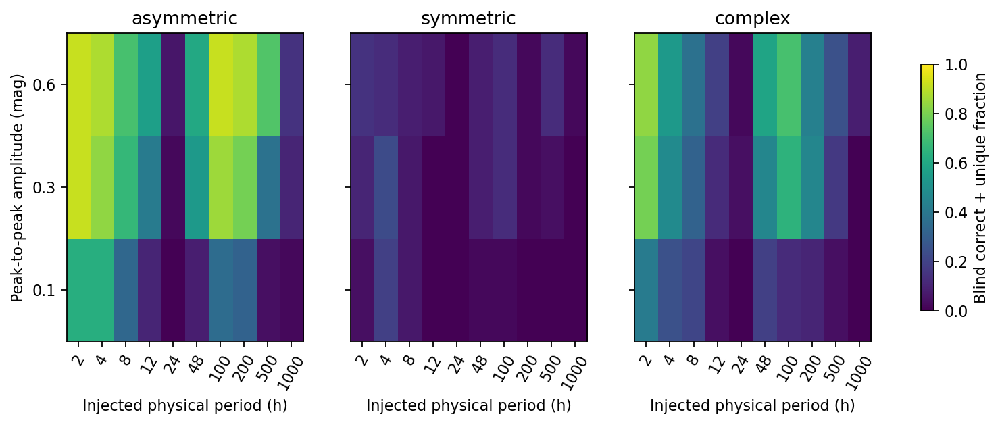

# SHARP 木星特洛伊年度监测方案

版本：2026-11-04；规划区间：2026-11-01—2027-10-31（北京时间夜次，内部UTC）。状态：本地模拟与项目申请材料，尚未现场执行。

## 结论与拟申请模式

建议将 **每夜最多两小时、r120、3—4场、每场连续两张** 作为年度候选主模式。当前交付的365夜完整曝光表采用四场驻场两张；三场同样值得在前三个有效夜实测后比较。两者基准年度合格光变的中位数均约42颗，四场在乐观精度情景下更高。没有为了达到百颗而降低质量门槛。

**两小时方案尚不能支撑“超过100颗高质量光变”的申请承诺。** 四场基准 P10/P50/P90 为36/42/47，乐观为55/62.5/70。全部24组标准对照均为0/200次达到101颗；这是本模型下的经验频率，不能解释成真实概率严格为零。二项抽样的一侧95%上限约1.49%，也不包含测光、天气和调度模型误差。

四小时、八场且假设r18单张随机误差约0.01mag时，P10/P50/P90为102.9/117/128.1，达到101的频率92%；这同时要求更高性能与更多时间，是追加时间的敏感性实验。尚未证明本仪器达到该精度，也未将四小时写入正常执行模式。

## 科学目的和独立计数

目标是可公开复用、支持自转研究的多夜时序，重点包括弱周期/别名检验、不同观测几何下的振幅变化、慢转候选和可靠控制源。主带对象只能是额外成果，未计入这里的 Trojan 数量。Lucy 的科学背景不等于这些场直接承担任务保障。

合格光变必须同时满足：≥100合格r点、≥10有效夜、每有效夜≥5点且跨度≥1800秒、基线≥21日；清洁点误差中位数≤0.03mag、至少80%≤0.05mag；单点夜零点偏移≤0.02mag，并检查按夜加权的零点RMS。严重极亮星场先排除，其余污染/坏点采用显式损失情景。所有数值是模拟判据，真实图像上的污染、饱和和系统误差仍须验证。

光变合格、周期正确且唯一、振幅恢复三者分别统计。对象第一次通过时保存合格前缀和完成证书，后续偶然落入场内的低质量帧不会删除已有合格数据；所有原始模拟点仍保留。如真实校准被推翻，必须另行重评，不能沿用模拟证书。

## 输入、季节与场版本

全量16445行JPL TJN母表逐行保留筛选结果；每周二体粗筛、H<14、V代理≤19.7、Dec≥−29°后得到1063颗。所有1063颗均有6小时采样的站心Horizons星历，覆盖全年及末端+3日恢复。12个独立逐小时查询的插值抽验最大位置差0.511角秒；不是对所有目标的逐点保证。缺H和粗筛拒绝项可审查，不能宣称人口样本完备。两云标签是瞬时黄经代理，不替代长期共振积分。

场组按35日科学campaign管理，场中心每7日产生新版本；跨版本按对象ID积累点数、有效夜、基线和完成状态。全足迹高度>30°，中心≥32.5°；月在地平线上时普通30°、照明≥75%时40°避让。可见菜单采用300秒网格并加时间角速度余量，实际名义曝光独立5秒复验。无共同窗口时正式输出零计划并释放时间。

| month | eligible_nights | eligible_objects | L4_proxy | L5_proxy | selected_field_versions |
| --- | --- | --- | --- | --- | --- |
| 2026-11 | 30 | 201 | 0 | 201 | 45 |
| 2026-12 | 31 | 228 | 5 | 223 | 53 |
| 2027-01 | 31 | 230 | 55 | 175 | 50 |
| 2027-02 | 28 | 215 | 103 | 112 | 39 |
| 2027-03 | 31 | 229 | 164 | 65 | 46 |
| 2027-04 | 30 | 202 | 201 | 1 | 44 |
| 2027-05 | 31 | 167 | 167 | 0 | 44 |
| 2027-06 | 30 | 74 | 74 | 0 | 24 |
| 2027-07 | 12 | 6 | 6 | 0 | 4 |
| 2027-08 | 0 | 0 | 0 | 0 | 0 |
| 2027-09 | 23 | 25 | 0 | 25 | 19 |
| 2027-10 | 30 | 104 | 0 | 104 | 42 |

表中的“eligible_objects”是该月至少一个候选场有完整两小时合法窗口的几何对象数，不是光变产额；不同月不可相加。L4/L5是上述代理标签。可见季由星历计算，不强制全年每月占用时间。

每场保留主目标与伴随目标。在每个场版本的实际计划访问上检查80%留场，未达到者标为secondary而非删除曝光记录。年内同一对象跨场去重。V<2恒星距场中心4.122°内的场采用保守排除；Hipparcos V<6补足Gaia亮端，参宿四不会再因Gaia缺失漏检。其余亮星、拥挤、CCD方向和坏区尚没有完整实测模型。

## 调度、cadence与时间账本

转场使用已有header正常分支模型并加2秒余量，与20/60秒预算取大；同场零转场，读出15秒，真正换滤镜10秒，进入块按未知前一指向60秒，末尾另留300秒交接。只有完整轮巡进入计划。额外延迟、读出/转场抖动及预约取消都进入年度执行账本。

| fields | dwell | points_per_field_P10 | points_per_field_P50 | points_per_field_P90 | gap_s_min | gap_s_P10 | gap_s_P50 | gap_s_P90 | gap_s_max |
| --- | --- | --- | --- | --- | --- | --- | --- | --- | --- |
| 2 | 1 | 16.00 | 17.00 | 17.00 | 135.06 | 340.60 | 395.40 | 415.99 | 456.04 |
| 2 | 2 | 18.00 | 20.00 | 20.00 | 135.00 | 135.09 | 136.12 | 540.51 | 591.71 |
| 3 | 1 | 10.00 | 11.00 | 11.00 | 135.06 | 562.09 | 604.02 | 644.64 | 661.79 |
| 3 | 2 | 12.00 | 12.00 | 12.00 | 135.00 | 135.09 | 135.99 | 895.61 | 934.45 |
| 4 | 1 | 8.00 | 8.00 | 8.00 | 135.06 | 752.72 | 800.93 | 844.41 | 874.52 |
| 4 | 2 | 8.00 | 10.00 | 10.00 | 135.00 | 135.09 | 135.89 | 1231.34 | 1285.20 |
| 6 | 1 | 5.00 | 5.00 | 5.00 | 135.10 | 831.66 | 1213.95 | 1249.20 | 1341.18 |
| 6 | 2 | 6.00 | 6.00 | 6.00 | 135.00 | 135.09 | 135.77 | 1907.42 | 2003.46 |

上表来自基准天气实现0的实际曝光，按场逐夜统计。同场连拍会产生约135秒的短间隔和较长回访间隔，不能用一个平均cadence代替。不同场组可能相距很远，因此这里的长间隔常比最初165秒/帧的手算大。周期对照见 `period_cadence_comparison.csv`；除主方案24对象×2相位外，其他策略使用8对象×1相位、每个都有三种形状，样本构成不同，仅作诊断，不能当作严格同目标的因果排序。

全年名义预留：Trojan 608.0小时，黄昏 314.0小时，清晨 312.0小时；−12°夜界内尚未分配 2289.1小时。预留时间包含交接和空隙，不等于曝光积分时间，也不保证当夜可执行。

## 共同天气与测光情景

200条全年天气序列供各策略共同使用，随机种子20261104。月可观测率来自历史资料；潜变量AR(1)相关系数0.55、部分云概率0.25、外部取消概率0.15、最大延时180秒、额外读出均值0.5秒、额外转场均值2秒、seeing中位2角秒均是规划情景。当前天气关闭可知，未来随机天气不可用于选场；仅使用已发生反馈、可预知几何与历史月天气先验。不同策略共用潜在扰动，不代表按真实绝对时刻重放同一片云。

三种精度以120秒、r18为参考：保守随机误差0.040/夜零点0.020/有效比例0.70；基准0.025/0.012/0.85；乐观0.015/0.008/0.95。逐点误差再依亮度、气团、月光和seeing变化，含0.005mag底噪。V暂作为r；颜色偏移±0.3mag可使源/背景主导项约改变15%—32%，不能用白光20.8极限替代r精度。精度情景覆盖较宽但不等价于经过校准的颜色误差传播。

| fields | dwell | scenario | P10 | P50 | P90 | P_ge101 | allocated_hours_P50 |
| --- | --- | --- | --- | --- | --- | --- | --- |
| 2 | 1 | conservative | 7.00 | 12.00 | 18.00 | 0.00 | 344.00 |
| 2 | 1 | baseline | 28.00 | 34.00 | 37.00 | 0.00 | 342.00 |
| 2 | 1 | optimistic | 38.00 | 43.00 | 49.00 | 0.00 | 342.00 |
| 2 | 2 | conservative | 6.00 | 13.00 | 18.00 | 0.00 | 344.00 |
| 2 | 2 | baseline | 28.00 | 34.00 | 37.00 | 0.00 | 340.00 |
| 2 | 2 | optimistic | 38.00 | 44.00 | 49.00 | 0.00 | 342.00 |
| 3 | 1 | conservative | 4.90 | 12.00 | 17.00 | 0.00 | 346.00 |
| 3 | 1 | baseline | 33.00 | 38.00 | 43.00 | 0.00 | 344.00 |
| 3 | 1 | optimistic | 48.00 | 55.00 | 61.00 | 0.00 | 345.00 |
| 3 | 2 | conservative | 6.00 | 13.00 | 19.00 | 0.00 | 346.00 |
| 3 | 2 | baseline | 36.00 | 42.00 | 47.00 | 0.00 | 342.00 |
| 3 | 2 | optimistic | 52.00 | 59.00 | 66.10 | 0.00 | 345.00 |
| 4 | 1 | conservative | 3.00 | 11.00 | 17.00 | 0.00 | 347.00 |
| 4 | 1 | baseline | 31.00 | 36.00 | 40.00 | 0.00 | 343.00 |
| 4 | 1 | optimistic | 47.00 | 55.00 | 60.00 | 0.00 | 344.00 |
| 4 | 2 | conservative | 4.00 | 13.00 | 18.10 | 0.00 | 346.00 |
| 4 | 2 | baseline | 36.00 | 42.00 | 47.00 | 0.00 | 342.00 |
| 4 | 2 | optimistic | 55.00 | 62.50 | 70.00 | 0.00 | 344.00 |
| 6 | 1 | conservative | 0.00 | 0.00 | 2.00 | 0.00 | 347.00 |
| 6 | 1 | baseline | 19.00 | 24.00 | 28.00 | 0.00 | 346.00 |
| 6 | 1 | optimistic | 39.90 | 46.00 | 53.00 | 0.00 | 346.00 |
| 6 | 2 | conservative | 2.00 | 8.00 | 13.00 | 0.00 | 346.00 |
| 6 | 2 | baseline | 32.00 | 37.00 | 41.00 | 0.00 | 346.00 |
| 6 | 2 | optimistic | 48.90 | 56.00 | 64.00 | 0.00 | 344.00 |

科学评分采用测光可用性×(0.75+0.25×文献权重)×剩余完成机会及已观测进度。达到点数/夜数但尚未满21日时降低占用、到期补齐；完成后不再获取主目标优先权。原始文献质量保持不变：2223是控制源，22180保留别名复核，未查到证据保持literature_unchecked。

| role | P10 | P50 | P90 |
| --- | --- | --- | --- |
| alias_review | 0.00 | 1.00 | 1.00 |
| control | 23.00 | 27.00 | 32.00 |
| known_other | 5.00 | 7.00 | 8.00 |
| literature_unchecked | 1.00 | 1.00 | 1.00 |
| unknown_or_weak | 4.00 | 6.00 | 7.00 |

各角色分位数不能相加得到总分位数。未核查对象不计为“首次周期”。年度逐对象表 `object_summary.csv` 给出采样和质量概率，完整200实现逐对象明细仍在本地产品目录。

## 周期与振幅恢复

实际采样注入2—1000小时、0.1/0.3/0.6mag、随机相位，以及非对称双峰、完全对称双峰、含四次谐波三种形状。主网格8640次拟合含盲搜和±5%外部先验。另对所有200天气实现中合格对象进行总体情景注入：可靠目录/模型周期优先，其余对象固定抽取对数均匀周期，三形状权重0.6/0.2/0.2。这是透明的示例人口先验，并非真实自转分布测量。

| scenario | mode | P10 | P50 | P90 | 错误但宣称唯一的比例 | 振幅恢复比例 |
| --- | --- | --- | --- | --- | --- | --- |
| baseline | blind | 24.00 | 28.00 | 32.00 | 0.05 | 0.98 |
| baseline | external_prior | 20.00 | 24.50 | 29.00 | 0.12 | 0.90 |
| optimistic | blind | 35.00 | 41.00 | 46.00 | 0.06 | 0.97 |
| optimistic | external_prior | 25.00 | 30.00 | 34.10 | 0.13 | 0.88 |

可靠恢复同时要求与真值相差<1%、竞争频率Δχ²≥9、周期移动±1%重新拟合后Δχ²≥9。后两项只是候选集合内的启发式，不是校准后的后验概率。对称双峰可能只能识别半周期，因此显式报告“错误但宣称唯一”的比例。算法先筛12个一阶峰及半/倍频，再局部二阶拟合，不能替代最终多阶Fourier/别名人工审查。振幅容差为max(0.05mag,20%)。

逐对象周期表另保存20相位箱覆盖率与最大相位空隙，均针对声明的注入周期，不把未知真周期的相位覆盖视为实测。总体注入采用Horizons光行时修正；代表网格以实际接收采样时刻同时生成与拟合信号。假设距离/相角已理想校正、形状和自转恒定，没有逐夜去均值。误差由平均亮度预测，未把自转亮度变化反馈到探测截断。先验和盲搜结果相互重叠，不能相加；这些也不是已经获得的周期或新发现数量。

## 百颗缺口与可执行决策

| fields | hours_per_block | sigma_r18 | P10 | P50 | P90 | P_ge101 |
| --- | --- | --- | --- | --- | --- | --- |
| 4 | 2.00 | 0.03 | 36.00 | 42.00 | 47.00 | 0.00 |
| 4 | 2.00 | 0.01 | 55.00 | 62.50 | 70.00 | 0.00 |
| 4 | 2.00 | 0.01 | 67.00 | 80.00 | 89.00 | 0.0050 |
| 8 | 4.00 | 0.03 | 54.00 | 62.00 | 68.00 | 0.00 |
| 8 | 4.00 | 0.01 | 84.00 | 96.50 | 104.00 | 0.23 |
| 8 | 4.00 | 0.01 | 102.90 | 117.00 | 128.10 | 0.92 |

标准两小时、四场在假定0.01mag性能下中位80颗，达101频率0.5%；只增加精度仍不足以稳健达到目标。四小时八场基准中位62，乐观96.5；只有额外精度实验中位117、概率92%，仍略低于设计中位120的愿望。正常调度器继续拒绝超过两小时，这些额外预算实验不能直接导出执行。

固定基准精度、全年无天气/预约/坏帧损失的同一策略名义实现也只有79颗，说明天气并非唯一瓶颈；这是该策略的对照，不是望远镜理论上限。主要限制包括可测亮对象密度、南天L4完整足迹窗口、月距、21日基线、≥10个有效夜、远转场和测光质量。尚未穷举所有场中心和全年全局最优解，不能据本结果证明其他调度不可能超过百颗。

建议申请文本先采用诚实的两小时情景区间，同时将“百颗”保留为需要额外资源与实测性能共同支持的升级目标。前三个有效夜固定r，测量r120误差—星等、夜零点、光晕、坏区、真实转场和有效点率；之后更新参数，重跑剩余年度，并按一项主要参数一次调整。无需等试观测才拥有完整年度设计。

## 交付、复现和边界

详见 [材料索引与复现](README.md)。365夜最终组合计划共37078条曝光，逐条独立5秒几何检查通过；预算与未占用时间闭合。全套35项回归测试通过。当前所有产出都是本地模拟，不含控制器合法token、真实图像的测光认证或服务器部署。原生产目录与MPC暂停状态未改。

- 完整需求正文：[年度要求归档](../annual_requirements_pro_20261104.md)。其额外附件未下载；实现依据是完整正文及已归档的原四份附件。
- [JPL SBDB Query API](https://ssd-api.jpl.nasa.gov/doc/sbdb_query.html) 与 [Horizons API](https://ssd-api.jpl.nasa.gov/doc/horizons.html)：全量 TJN 分类与兴隆站心星历。
- [TESS 2025 重分析，A&A 693 A66](https://arxiv.org/abs/2501.07189)：保留周期区间、备选解和质量信息。完整表已取得，9912行，不再列为缺失输入。
- [Li 等 2025，Icarus 438, 116609](https://doi.org/10.1016/j.icarus.2025.116609)：216颗 Trojan 周期，其中80颗此前无已知周期；不能把目录未命中自动当作新周期。
- [Huang 等 2026，KMTNet](https://arxiv.org/abs/2606.26184)：长期高重复采样的科学参考，三站和目标样本不同，不能按面积换算 SHARP 产额。
- [兴隆历史天气研究，MNRAS 511, 5363](https://academic.oup.com/mnras/article/511/4/5363/6543517)：使用已发表月度可观测率；可观测夜不等于高精度测光夜。逐年数字见 `data/weather_prior.json`。
- [Durech 与 Hanus 2026 模型](https://arxiv.org/abs/2610.06082)、DAMIT、冻结 LCDB2023、TESS DR1 与人工文献审查共同保留；并非最新文献的完备普查。
