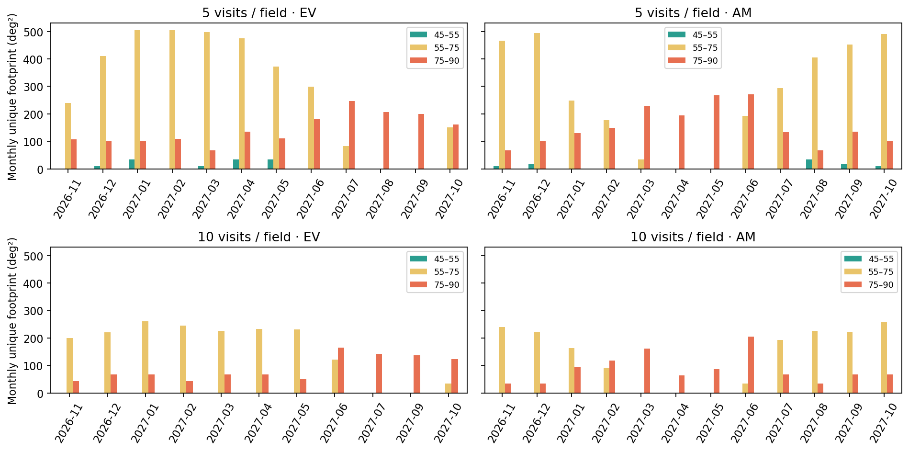
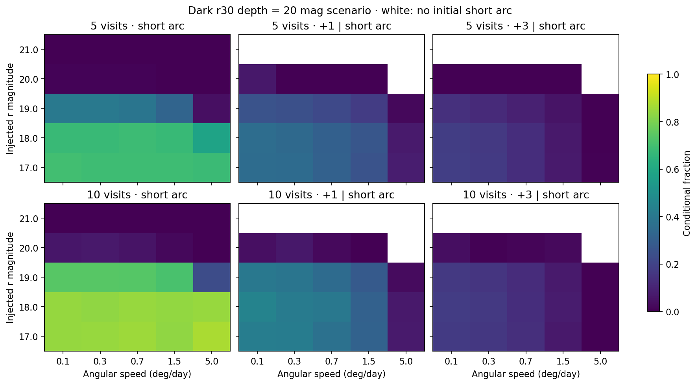

# SHARP 晨昏年度观测方案

版本：2026-11-04；规划区间2026-11-01—2027-10-31，共365夜、730个晨昏窗口。状态：本地设计与条件效率模拟。

## 方案与科学范围

保留 **r30、每侧最多一小时、两组各四场五访** 为覆盖基线，同时交付一组四场十访的全年对照。晚窗从太阳降到−12°开始，晨窗在太阳升到−12°结束。这一小时包含部分暗夜，不等同于−12°到−18°的天文暮光。高度门槛使极小距角不可达，因此报告把45—55°、55—75°与75—90°分别列出，后者称扩展搜索。

科学目标包括低距角小天体搜索、短弧确认与恢复机会的量化。没有使用归一化NEO轨道人口模型，**不报告年度绝对发现数**。当前生产处理速度约3—63角秒/小时，不因为天区已排好就自动具备高速NEO发现能力；快于这个范围的模拟只说明几何/测光潜力。

## 时间、几何与组间切换

读出15秒、换片10秒、转场采用实测正常分支下限加余量；晨昏相邻阈值3.5°并检查闭合回跳，未知进入指向预算60秒。全足迹高度>30°、中心≥32.5°；黄纬±25°、月距30/40°、太阳高度≤−12°。每组完整曝光才保留，剩余不足不塞入不完整组。晚上先小距角后大距角，早晨相反。

五访模式每侧最多40张，四场轮巡产生约20分钟弧段；十访也是最多40张，单组持续更久。最终间隔以逐曝光时间为准。十访对漏帧更稳健，但低高度场更难维持一个完整窗口。45°附近必要高度关系只是下限，五/十访全过程还须同时合法。

## 全年场与三有效夜锚点

名义年度每夜都有主组或明确零计划。天气队列使用当晚和过去14日的合法场组菜单，原锚点只有形成≥4次、跨度≥720秒的有效采样后才累积一个有效夜；达到三有效夜后优先新场。场组被局部修复时按field ID保留已完成有效夜，不能无限重置年龄。几何失效或主备不兼容时记录替换原因。

已有原11月6日丢锚点回归保留，年度版本进一步保存每个窗口的选中组、保留数和替换理由。队列没有提前使用未来随机天气；可预知几何是允许的。菜单只含历史/当前生成组，未穷举所有连续天区；真实待恢复候选及不确定区尚未接入，因此下述恢复只是扫描策略的机会，不是候选驱动后随的完整系统。

## 覆盖面积：必须区分四种口径

名义全年几何覆盖，HEALPix nside1024，约0.00328平方度/像素：

| visits | exposure_area_deg2 | unique_year_deg2 | qualified_short_arc_unique_year_deg2 | area_on_ge2_nights_deg2 | area_on_ge3_nights_deg2 |
| --- | --- | --- | --- | --- | --- |
| 5 | 225360 | 6180.93 | 5772.11 | 5390.17 | 5150.74 |
| 10 | 208080 | 3812.19 | 3513.03 | 3370.40 | 3234.71 |

exposure_area是9平方度×曝光张数，仅是曝光面积之和。unique_year按球面足迹去重；qualified_short_arc采用缩进0.15°边界后的足迹，要求同窗口累计≥4访/≥12分钟；两夜/三夜是不同北京时间夜次重复。单月面积不能直接相加得到全年独立面积。nside512与1024的相对差异见 `healpix_convergence.csv`，有限像素化误差保留。

天气实现0的实际有效帧重放（与因果队列逐窗口good_exposures和qualified_fields逐项核对）：

| visits | unique_year_deg2 | qualified_short_arc_unique_year_deg2 | area_on_ge2_nights_deg2 | area_on_ge3_nights_deg2 |
| --- | --- | --- | --- | --- |
| 5 | 4344.88 | 3745.08 | 3624.91 | 3176.23 |
| 10 | 2694.80 | 2432.07 | 2311.82 | 2048.78 |

这张表已扣除天气关闭、预约取消、云、迟到、几何失效和坏帧，尚未施加星等相关检出概率。它是一个共同天气实现的面积，不能当作200次面积分布的中位数。200次实现分别有146000条窗口记录；五访/十访的合格场窗口数P10/P50/P90为1922.5/2125.5/2336与1144.8/1256/1370.6，同一场不同夜重复计数，不能直接乘9当作全年面积。

图按每次曝光中点的场中心太阳距角分箱，每月/早晚/箱内去重足迹。一个场可能跨箱，所以不同箱也不能相加后声称完全独立面积。本次五访方案45—55°仅有少量覆盖，十访方案没有该箱覆盖；大部分属于55—75°及75—90°，不能将全数包装成极低距角巡天。完整表 `twilight_monthly_elongation.csv` 保留月份、晨/昏及策略；没有低距角合格场时允许只排扩展区或零计划。

## 移动源注入与恢复

速度取0.1/0.3/0.7/1.5/5度/日，星等17—21，每个已排窗口/速度/星等单元12个随机位置方向。注入位置在已选足迹内均匀分布，沿大圆恒角速移动三日；不是轨道人口模型，没有加速度或真实NEO轨道偏好。每个初始窗口轮换使用200天气实现之一，后续+1/+3日沿用同一实现及相应因果选场，不偷看未来随机天气。

检出概率采用logistic宽度0.25mag；r30暗夜深度分别19/20/21mag三情景，加入最长0.8mag暮光罚项、气团消光、月光、seeing及拖线损失。移动源检出未另加真实CCD坏区掩膜，也未生成图像或假源；这些额外损失需实测，因此效率仍偏理想化。窗口初始已关闭的情况单列在执行账本，未混入“给定已排窗口”的效率分母。末年+1/+3日超出申请区间的恢复右删失，不当失败计数。输入星历/IERS仍留有+3日余量。

以下为r18、暗夜深度20mag情景；所有数值均为条件比例：

| visits | speed_deg_day | tracklet_fraction | plus1_given_tracklet | plus3_given_tracklet | within_existing_rate_range |
| --- | --- | --- | --- | --- | --- |
| 5 | 0.10 | 0.68 | 0.36 | 0.18 | True |
| 5 | 0.30 | 0.68 | 0.34 | 0.17 | True |
| 5 | 0.70 | 0.69 | 0.31 | 0.13 | False |
| 5 | 1.50 | 0.67 | 0.27 | 0.07 | False |
| 5 | 5.00 | 0.58 | 0.07 | 0.0023 | False |
| 10 | 0.10 | 0.84 | 0.45 | 0.18 | True |
| 10 | 0.30 | 0.83 | 0.42 | 0.17 | True |
| 10 | 0.70 | 0.85 | 0.40 | 0.13 | False |
| 10 | 1.50 | 0.84 | 0.31 | 0.08 | False |
| 10 | 5.00 | 0.84 | 0.07 | 0.0015 | False |

tracklet_fraction要求同夜≥4次检出且跨度≥12分钟。plus1/3_given_tracklet的分母为初夜已成功短弧且后续未删失，后夜允许晨或昏任一窗口形成短弧。完整三深度×五星等×五速度结果见 `moving_recovery.csv`，另有以全注入为分母的联合成功率。

**同场复拍从未直接算作目标恢复。** 每次都推进目标位置并检查实际新足迹；5度/日移动天体通常迅速离开3度视场。这里的后续成功是利用注入真值关联的上限，没有假源、轨道歧义或实际链接算法，不能称为真实连接成功率。当前处理范围只包含表中的0.1、0.3度/日两档；0.7、1.5、5必须单列，未来改造检测程序还需要真实图像注入与误报评估。

## 选择与三夜校准

两组五访在同样40张上限下通常覆盖更广；十访可为较高漏检率提供更多冗余，但不一定提高跨夜恢复。申请先保留五访基线及十访对照，不能只看曝光数或某一星等成功率作决定。因未归一化人口，当前不能据效率表断言哪一种绝对NEO产量更高。

首三个有效夜保持r30和主要读出设置，实测天空背景随太阳高度/气团/月距变化、检出完整率、拖线损失、转场、坏区和tracklet误报；选择已知移动目标做真实再获取。然后以实际深度替换19/20/21情景，校准三有效夜更新规则和快速确认时效，重新生成余下年度。明亮NEO确认、彗星活动等机会任务可作为后续独立优先队列，当前未暗中占用YSO/SN/public项目时间。

## 交付、限制与来源

两种模式各365份名义夜计划/730窗口；200条因果执行序列；主方案与Trojan组合后365夜共37078条曝光，独立5秒复验通过。各夜显式零计划和未分配区间可查。控制器token/定时接口、实际快速目标检测和现场发布尚未启用，未连接服务器。

所有表和复现命令见 [材料索引](README.md)。[Bolin等2024 ZTF晨昏研究](https://arxiv.org/abs/2409.15263)提供分组多访和后随的科学参考；不同地平限制不可直接移植其覆盖或发现率。共同天气来源及输入与Trojan报告相同：

- 完整需求正文：[年度要求归档](../annual_requirements_pro_20261104.md)。其额外附件未下载；实现依据是完整正文及已归档的原四份附件。
- [JPL SBDB Query API](https://ssd-api.jpl.nasa.gov/doc/sbdb_query.html) 与 [Horizons API](https://ssd-api.jpl.nasa.gov/doc/horizons.html)：全量 TJN 分类与兴隆站心星历。
- [TESS 2025 重分析，A&A 693 A66](https://arxiv.org/abs/2501.07189)：保留周期区间、备选解和质量信息。完整表已取得，9912行，不再列为缺失输入。
- [Li 等 2025，Icarus 438, 116609](https://doi.org/10.1016/j.icarus.2025.116609)：216颗 Trojan 周期，其中80颗此前无已知周期；不能把目录未命中自动当作新周期。
- [Huang 等 2026，KMTNet](https://arxiv.org/abs/2606.26184)：长期高重复采样的科学参考，三站和目标样本不同，不能按面积换算 SHARP 产额。
- [兴隆历史天气研究，MNRAS 511, 5363](https://academic.oup.com/mnras/article/511/4/5363/6543517)：使用已发表月度可观测率；可观测夜不等于高精度测光夜。逐年数字见 `data/weather_prior.json`。
- [Durech 与 Hanus 2026 模型](https://arxiv.org/abs/2610.06082)、DAMIT、冻结 LCDB2023、TESS DR1 与人工文献审查共同保留；并非最新文献的完备普查。
