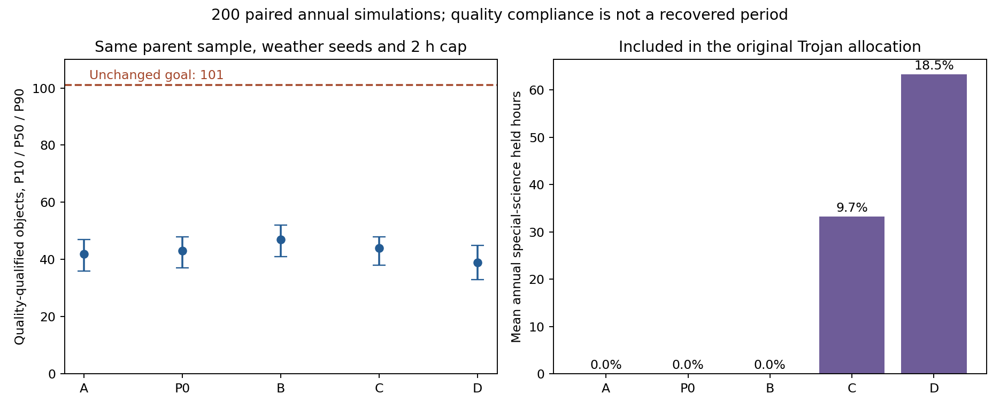
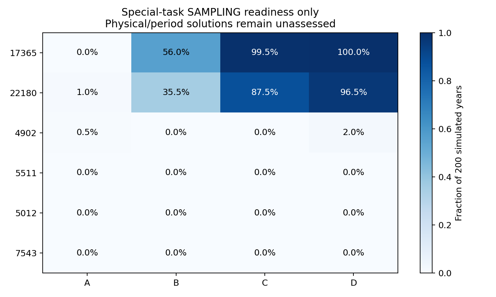

# Trojan：去重修复与四组年度配对比较

## 结果

共同条件：2026-11-01—2027-10-31、365夜、同1063颗站心星历母样本（来自16445 TJN的固定筛选）、兴隆、r120、四场×驻场两张、每夜至多7200秒，含读出/换片/真实转场/300秒交接；同200条天气、预约、晚到、部分云和随机种子。基准测光参数为r18/120s随机误差0.025mag、夜间零点0.012mag、有效点比例0.85，均是假定情景。

| 策略 | 合格光变 P10/P50/P90 | 相对A的配对平均变化 | 实际科学份额（均值） |
|---|---:|---:|---:|
| A 原四场两张 | 36 / 42 / 47 | 0 | 0 |
| P0 同旧菜单，仅修复排序 | 37 / 43 / 48 | +0.88 | 0 |
| B 修复＋偏置场中心＋路线评分 | 41 / 47 / 52 | +5.10 | 0 |
| C B＋10%特殊科学上限 | 38 / 44 / 48 | +1.34 | 9.73% |
| D B＋20%特殊科学上限 | 33 / 39 / 45 | −2.99 | 18.54% |

A重新运行的200个年度计数与原冻结结果**逐项完全一致**。每个策略都按对象稳定ID去重，并独立核对逐对象证书与年度计数。所有本轮标准情景仍为0/200次达到101。B全天晴名义对照为86，不能替代天气实现的中位47。

仅修复P0时，天气实现0的160个共同有效夜里，有73夜改变开始时刻、117夜改变场组合；曝光5924→5936。乐观测光P0为55/62.5/70→57/64/72，配对平均+1.705。单个反例的10→12分不是全年产额提升20%的证据。P0的开始时刻对比仅限保存了逐曝光时间的实现0；B/C/D与A另有全部200实现的决策对照。

B、C、D的年度平均占用分别340.98、341.66、341.80小时；科学块平均0、33.25、63.31小时，全部包含在这些总时间内。前缀累计和年末科学时间都不超过对应10%/20%上限。达不到份额时保留实际值，不用不可见目标补足。普通天区内的附带科学目标不另重复计时。

## 改动如何工作

1. **时段先去重。** 每个允许的开始时段先形成独立对象的贪心场组合，再比较收益。所有合法场参与，移除原无证明的top32场截断；并列轮换也用去重收益。保留 `pick_legacy` 复现A。
2. **预测参数一致。** 完成机会预测读取统一quality门槛，不再硬编码21日/10夜/100点。`--science-strength 0`只关闭文献权重；预测由独立开关控制。默认policy版本为4，A显式采用3。
3. **自由场中心是有限候选搜索。** 原中心全部保留，增加相距≤3.8°的目标对球面中点及局部目标群质心；每7日版本重新计算，统一V≤19.2、足迹、月光与极亮星排除。不是连续空间全局最优。新菜单独立存放，不覆盖旧菜单。
4. **路线参与比较。** 每个时段的去重组合最多4场，枚举最多24种巡回顺序；用同一转场模型计算可完成整圈、真实点数与有效夜跨度，点数不足会降低收益。组合搜索仍是贪心，未证明全局最优。
5. **特殊任务不因普通质量达标停止。** 科学块重新评估任务状态；长周期候选相邻专门采样至少隔3夜，短周期至少隔1夜。可见性、份额和真实开销同样受限。这一轮仍以整块2小时分配科学队列，尚未优化为每个慢转源3–5帧的混合短子块，所以不把D解释为慢转项目的最优方案。

P0的42→43是单修复对照；B的提升包含候选中心与路线两项改动，不能把全部提升归于其中一项。

## 特殊任务：采样进度，不是物理解完成率

保留原16候选的多标签、论文周期和不确定性说明。先用同一年度星历重评：17365、22180、4902、5511等有足够窗口；21900、15094、13383、624、3548、11351在当前整场、两小时、月距与亮星限制下没有合法窗口。38615、228155不在原年度预选母样本；为保持配对公平未额外加入。详细原因见[16对象审计](special_availability_audit.csv)，原代表月几何没有作为新排程输入。

采样代理定义：至少100个满足任务误差上限且零点≤0.02mag的点、至少14个有任务好点的夜次、基线≥max(21日,3×最长候选周期)、每个候选周期20个相位箱覆盖≥80%。误差上限为min(0.03mag,已知振幅/5)，无振幅时用0.03。这是人工声明的比较门槛，**不是论文证明的充分条件**；相位箱使用近似候选周期/观测时刻，不替代光行时/相位角校正后的物理拟合。与普通quality门槛分开。

| 对象 | B采样就绪率 | C采样就绪率 | D采样就绪率 | 解释 |
|---|---:|---:|---:|---|
| 17365 Thymbraeus | 56.0% | 99.5% | 100% | 10%份额已经大幅改善覆盖；双叶/哑铃模型验证仍待测光与正演 |
| 22180 Paeon | 35.5% | 87.5% | 96.5% | 特别采用约0.0185mag点精度要求；保留19.39/26.1284h候选，未把宽TESS区间变成精确真值 |
| 4902 Thessandrus | 0% | 0% | 2.0% | C/D中位好点基线约104日，但相位覆盖仍不足；长基线不是充分条件 |
| 5511 Cloanthus | 0% | 0% | 0% | 普通质量高达标率不等于322–336h模型验证完成 |
| 5012 Eurymedon | 0% | 0% | 0% | 低振幅要求更高精度；不因目录周期不同就宣布新发现 |
| 7543 Prylis | 0% | 0% | 0% | 763.7h候选需约96日以上；当前低振幅好点覆盖不足 |

`photometric_complete`依据通用测光证书；`sampling_ready`按上述代理；`period_solution_complete`和`science_case_complete`一律未知。别名窗口评分使用相对既有观测的候选相位分离和新相位覆盖，没有可靠相位零点/形状模型时，不冒称已预测具体极小或实际光度分歧。事件条件候选只参与普通总光度/模型基线采样，未触发互掩/互食观测。

仍应保留对617的线性/饱和现场检查、对低振幅源的真实r精度检验，以及慢变源统一跨夜零点；当前模拟不包含探测器饱和或完整场内污染模型。上述代理率不能当真实观测成功概率。

## 来源和检验

原候选与逐条引文保存在 `data/special_science_candidates.json`，原ZIP SHA记录于 `source_archive.json`。本轮重新核对了[Carry等2023摘要](https://arxiv.org/abs/2309.15537)：Thymbraeus支持双叶/哑铃形，不能称已确认分离双星；[Vavilov & Carry 2025](https://arxiv.org/abs/2501.07189)明确保留不确定区间和可能别名；[Li等2025](https://arxiv.org/html/2504.15530v2)及[2026形状/自转研究](https://arxiv.org/abs/2610.06082)用于区分已有周期重测和新约束。其余逐对象详细数值沿用已归档原始表与审查证据，不声称本轮重新读完每篇全文。

测试覆盖最小反例（预测开/关）、空/单/重叠/并列场、完成状态、非默认质量阈值、路线改变选时段、特殊任务跨越普通达标、缺日期/坐标/来源/错误SHA、末年右删失布尔解析。比较器强制365×200完整性、逐对象唯一性、计数一致、时间闭合、科学份额前缀/年末约束及原A复现。
