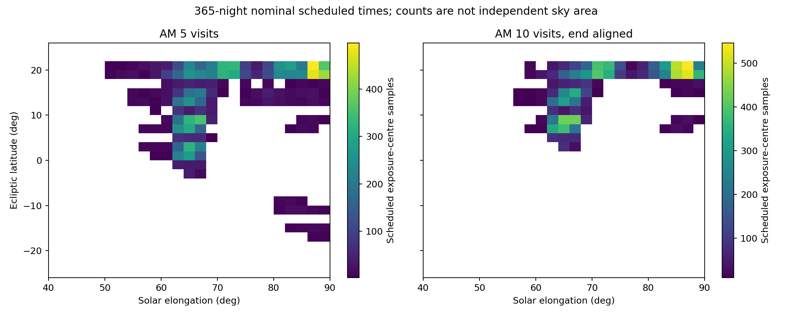

# 晨昏：五访基线与晨间十访后对齐

**当前结果支持把十访保留为提高单场短弧完整性的可选模式；不支持宣称它增加总覆盖或更接近太阳。** 此比较独立于Trojan科学预算，不默认替换原五访设置。

## 模式与验证

- 基线：EV和AM各两组四场、每场五访，r30，各侧60分钟。
- 新比较：EV保持原五访；AM为四场十访，将末次读出结束安排在太阳升到−12°前30秒；全小时仍保留，首帧前等待明确记账。读出15秒、实际转场模型及换片开销保持原值。
- 沿用相同已冻结的14日历史候选菜单，把晨间十访实际曝光重新后移后逐场检查，再做独立5秒逐曝光几何/时间验收。没有假设旧天区平移时间后仍然合法。
- 完成365夜/730窗口；新旧各200条共同天气/预约实现。清晨不能因延迟越过截止：仿真仍采用原来的累加延迟模型，较晚曝光可能丢失，保守地不把等待时间用于吸收晚到。
- 本轮未重新优化一套更靠近太阳的新晨间场网格。候选是同一原菜单的后对齐比较；没有将有限候选搜索称为最优巡天。

## 覆盖与有效短弧

| 指标 | 原EV5/AM5 | EV5/AM10后对齐 |
|---|---:|---:|
| AM全年合格场窗口 P10/P50/P90 | 945.9 / 1041 / 1157 | 538.9 / 609.5 / 660.2 |
| EV全年合格场窗口 P10/P50/P90 | 953.9 / 1080 / 1194.2 | 完全相同 |
| 名义全年双侧独立面积（deg²） | 6180.93 | 5129.69 |
| 名义至少两夜覆盖的独立面积（deg²） | 5390.17 | 4339.07 |
| 天气实现0实际有效帧双侧独立面积（deg²） | 4344.88 | 3512.23 |
| 实现0相隔1夜合格短弧公共面积累计（deg²·夜对） | 5723.74 | 5375.50 |
| 实现0相隔3夜合格短弧公共面积累计（deg²·夜对） | 3405.10 | 2636.14 |

面积用同一nside=1024的HEALPix球面像素中心包含算法；不是曝光张数×9deg²。重复面积每个像素只计一次；deg²·夜对会累计不同夜对，不等于独立面积。后一类仍是静态天区公共覆盖，移动目标恢复另算。

图使用各曝光真实计划中点计算太阳距角、黄纬；颜色是曝光中心采样数，**不是去重面积**。原AM5曝光中心距日角P10/P50/P90=63.21/67.89/86.93°，后对齐十访为63.78/69.59/86.92°。本次选场没有改善小距日角分布；不可由“更晚观测”推断“更靠近太阳”。四场十访覆盖更少天区，留下更多点数余量，所以合格场窗口总数降低，但单个已覆盖移动源更容易形成短弧。

## 条件移动源注入

三种假定暗空r30极限19/20/21、五档星等17—21、五档角速度0.1/0.3/0.7/1.5/5deg/day，采用相同天气种子。含气团、seeing、月光、拖线及窗口位置天光损失；固定角速度大圆传播至+1/+3夜，使用真值关联。**不是归一化NEO人口、真实链接器或绝对发现数预测。** 不同策略覆盖场不同，因此同种子的条件注入不是同一颗天体的逐对象配对。

示例：暗空r30极限20、注入r19、晨间已有调度窗口，短弧要求至少4点且跨度≥720秒：

| 速度（deg/day） | AM5短弧率 | AM10后对齐短弧率 | +1夜恢复率：AM5→AM10（条件于已有短弧） |
|---|---:|---:|---:|
| 0.1 | 42.31% | 71.23% | 29.92% → 39.37% |
| 0.3 | 41.80% | 72.29% | 27.09% → 38.49% |
| 0.7 | 40.84% | 71.60% | 23.45% → 36.28% |
| 1.5 | 34.44% | 67.94% | 19.25% → 27.83% |
| 5.0 | 4.42% | 16.30% | 1.04% → 0.66% |

+1/+3恢复必须在初夜及后续夜分别形成合格tracklet；后续夜可来自EV或AM。末年无法取得+1/+3夜的条目保留缺失值，不当失败或成功。解析时使用可空布尔，避免把字符串`False`转换成真。完整三深度/速度/星等结果及分母见 [twilight_conditional_recovery.csv](twilight_conditional_recovery.csv)。+3夜收益并非单调，快目标尤其需要真正的轨道预报跟进；重拍静态锚点不等于恢复成功。

上述单场效率的改善需与独立面积损失一起考虑，不能把71%直接当成整个巡天发现率。原生产检测速度范围3–63角秒/小时也未因此扩展；快速NEO处理和确认链路尚待单独验证。

## 实施与验收文件

代码：`annual_morning_alignment.py`，混合组次通过`visits_by_side`进入独立validator；原五访没有变化。几何与数据分别为 `morning_scheduled_geometry.csv.gz`、`twilight_comparison.csv`、`twilight_*_paired_window_totals.csv`、`twilight_provenance.json`。完整365夜计划/菜单/逐次条件注入位于本地 `products/annual/twilight_morning10_aligned/`；小型复核表已提交，原运行缓存不提交。
